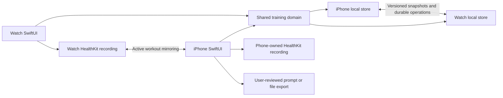
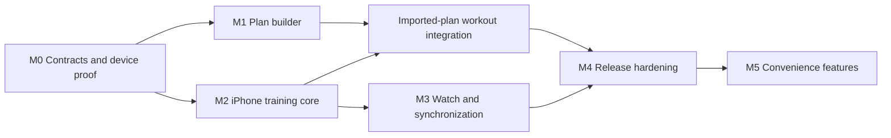

# Form / Flow — Native iOS + watchOS

Product requirements and implementation plan

Updated: 2026-09-18. Status: Native development build implemented; release verification remains open.

Implementation checkpoint: `native/` contains runnable SwiftUI iPhone/Watch targets and `packages/FormFlowCore/` contains the shared training domain. The development build covers profile → external-AI prompt → import/edit/review → activation → recording → history/recovery/progression, with typed intervals/alternatives, backups, optional Health recording and durable Watch transport. The original web program is bundled for explicit review. Both apps compile and launch in Simulators; shared, persistence and UI test suites have run. Physical-device reliability, full accessibility, performance, legacy-record usability and release acceptance are still open. See [native/README.md](native/README.md) for current build instructions and [native/HEALTH_VERIFICATION.md](native/HEALTH_VERIFICATION.md) for device gates. Implementation is not evidence that every release scenario below has passed.

## 1. Product direction

Build a native, private workout planner and tracker for iPhone and Apple Watch. The iPhone helps people create a plan, understand their training, and decide what to do next. Apple Watch helps them perform and record a workout with minimal interaction.

The primary new-user journey is:

**Training profile → Copy AI prompt → Import AI response → Review weekly plan → Train → Check recovery → Adjust future training.**

People without an existing plan answer questions about their goals, experience, schedule, equipment, optional bio, and limitations. Form / Flow generates a prompt they can paste into their preferred external AI service. They bring the response back, review the imported plan, and activate it. Form / Flow does not require an AI subscription, API key, or account of its own.

People who already have a plan can import it directly. Existing web users can migrate their records using a JSON backup. Both groups then use the same native training experience.

This PRD records the agreed user journey and proposes the implementation details needed to build it. Minimum OS versions, delivery estimates, and release boundaries below are planning defaults, not previously confirmed hardware or launch commitments.

## 2. Problem and intended users

The current project works well as a private browser-based log, but new users must already have a program or arrange a compatible plan file. Creating a personalized weekly plan, turning an AI response into something trackable, and recording it during exercise are disconnected tasks. A browser also cannot provide the intended native Watch recording and device integration.

| User | Need | Observable outcome |
| --- | --- | --- |
| New or returning exerciser | Help describing goals, experience, and constraints | Creates a prompt and activates a reviewed weekly plan without editing JSON |
| Person with an existing plan | Bring their program into the tracker | Imports a supported plan and reviews how it maps to days and exercises |
| iPhone-only user | A complete training workflow without a Watch | Logs, pauses, resumes, finishes, and reviews a workout on iPhone |
| Apple Watch user | Record training with the phone out of reach | Finishes a previously synchronized workout offline and reconciles it later |
| Existing Form / Flow user | Keep accumulated history and progression | Migrates records without changing their meaning or duplicating completed workouts |

Initial planning audience: adults doing general strength, cardio, and mobility training. Injury information describes user-reported constraints; the product does not diagnose conditions, prescribe rehabilitation, or provide medical clearance. Specialized clinical and youth programming require a separate product scope decision before being marketed as supported.

## 3. Goals, scope, and success criteria

### 3.1 Goals

1. Give a person starting without a plan a complete path from questions to their first recorded workout.
2. Make routine set completion possible with one prominent action when the displayed values are correct.
3. Preserve records through interruption, device disconnection, repeated messages, and plan revisions.
4. Preserve the existing separation between planned targets, actual performance, recovery, recommendations, and accepted changes.
5. Keep personal information local to the apps by default and make any user-directed export explicit.
6. Share training behavior between platforms while designing each interface for its device.

### 3.2 Release scope

| Capability | First native release | Later |
| --- | --- | --- |
| Training profile and external-AI prompt builder | Required | Prompt variants informed by optional, user-selected history |
| Private plan import, validation, review, editing, and activation | Required | More provider-specific handoffs and richer editing tools |
| Supported legacy plans and backup migration | Required | Additional third-party import formats |
| iPhone logging, rest timer, history, recovery, and basic trends | Required | More detailed analysis |
| Watch cached plans, offline logging, timers, and synchronization | Required | Fully independent Watch setup without an iPhone |
| HealthKit workout recording | Required, with manual logging fallback | Broader external-workout matching and correction tools |
| Existing built-in progression behavior | Required, with parity verification | Additional explicitly supported policies for imported plans |
| Imported-plan progression | Manual by default; only supported and validated policies may run | Additional policy types |
| Manual sleep and body tracking | Required | Optional Health sleep/body imports with source reconciliation |
| Live Activities, complications, and shortcuts | After core release gates pass | Expanded controls and automation |
| App-managed cloud sync | Deferred | Evaluate separately if users need additional devices or backup |

### 3.3 Explicit exclusions from the first release

- Embedded LLM calls, vendor accounts, API-key entry, and automatically transmitting profile data to an AI provider.
- Social feeds, public profiles, coaching marketplaces, payments, and a custom backend.
- Automatic rep detection or exercise recognition.
- Arbitrary executable coaching rules supplied by an imported plan.
- AI decisions that silently change a plan or mark a person recovered.
- Importing arbitrary PDFs, screenshots, or unstructured prose as if they were reliable structured plans. Users can give those materials to their AI along with the app's conversion prompt.
- A rich drag-and-drop program authoring system. First-release editing covers days, sessions, exercises, alternatives, and supported numerical prescriptions.

### 3.4 Proposed success measures

These are release targets to validate, not measurements of the current app. Evaluate with synthetic fixtures and consenting usability participants; do not add remote product analytics to measure them.

| Measure | Proposed gate |
| --- | --- |
| Onboarding usability | At least 4 of 5 representative participants activate a plan without developer help or manual JSON editing |
| In-app setup time | Median under 5 minutes, excluding time spent using the external AI and reading its advice |
| Set completion | One tap when prefilled values are correct; visible local save acknowledgment within 250 ms at p95 on the minimum supported test device |
| Import performance | A plan at the supported size limit validates within 2 seconds on the minimum supported iPhone |
| Data durability | No lost acknowledged sets or duplicate records in the defined interruption and replay tests |
| Behavioral parity | All applicable progression, recovery, unit conversion, and migration fixtures pass in Swift |
| Accessibility | Core onboarding, import, workout, and review flows complete using VoiceOver and supported large text sizes |

## 4. Current project and reuse strategy

Baseline verified against the repository on 2026-09-14: the project was a static JavaScript application with no native targets or backend. The following reuse analysis describes that baseline; native targets were added on 2026-09-18.

| Existing source | Relevant behavior | Native treatment |
| --- | --- | --- |
| [README.md](README.md) | Privacy model, logging, recovery, progression, and backup behavior | Preserve product semantics; update native documentation separately |
| [index.html](index.html), [styles.css](styles.css) | Today, Week, Progress, Data; forest, paper, and lime identity | Redesign with native navigation and controls |
| [app.js](app.js) | UI state, drafts, date/plan keys, target acceptance, and persistence | Replace UI/storage orchestration; move acceptance guards into the domain layer |
| [lib.js](lib.js) | Built-in plan, measurement types, normalization, history, and recovery | Port pure behavior and extract versioned plan data |
| [progression.js](progression.js) | Qualification and next-session target rules | Port into a shared, tested Swift package |
| [scripts/plan-utils.mjs](scripts/plan-utils.mjs) | Public version-1 plan validation | Retain compatibility and define a stronger native interchange contract |
| [plans/README.md](plans/README.md) | Public folder-plan format and generator instructions | Basis for a private prompt/import workflow; public publishing remains separate |
| [tests](tests) | Existing behavior and regression examples | Convert applicable cases into shared data fixtures and Swift tests |

Important migration constraints:

- Current workout keys are one record per plan and date. Native needs multiple sessions within a day and stable session identities.
- The existing validator supports `weight_distance`, even though the plan README's measurement list omits it. The implementation and fixtures must determine compatibility behavior.
- Carry distance and cardio distance use different legacy units. Native quantities must carry explicit units.
- The built-in long-run program currently has 18 stages. Port the source data; do not reconstruct it from the README's older count.
- Current guided coaching is limited to the built-in plan and does not automate Block 2 quality-run programming. A native port must not broaden those rules implicitly.
- Existing private backups and public plan files are different formats. Import must identify which was supplied before processing it.

## 5. User experience

### 5.1 iPhone navigation

| Destination | Contents |
| --- | --- |
| Today | Due check-ins, today's sessions, start/resume, extra activities, and post-workout review |
| Plan | Active plan, weekly schedule, plan builder, import, exercise guides, alternatives, and progression roadmaps |
| Progress | Workout history, exercise trends, cardio totals, sleep, body measurements, and recovery patterns |
| Settings | Units, data export/import, local deletion, privacy, app lock, and Health integration |

Before a plan is active, Today presents the onboarding entry points. After activation, Today prioritizes the next session. An interrupted workout takes priority over starting another copy of the same scheduled session.

### 5.2 Welcome and training profile

Primary action: **Create my plan**. Secondary action: **Import an existing plan**. A starter plan may be available as an optional shortcut. Returning users bypass onboarding.

Explain the complete external-AI journey before the first question: **Build your training brief, copy a prompt into your preferred AI, then bring its plan back here to review.** The app does not generate a plan itself. Any bundled sample is labeled as a format example and requires review before activation.

The questionnaire consists of short screens, saves after each change, and resumes after app termination. Users can review and edit all answers before generating a prompt.

The user's clarification to design finding D1 is adopted: collect enough relevant context to personalize the plan; a smaller screen count is not the goal. Present background and preferences as part of the main journey, with clear skip choices for sensitive information. Adapt follow-ups to experience, equipment, goals, and reported limitations. The brief distinguishes supplied facts from unknown or withheld information, and the generated prompt asks the external AI to seek consequential missing context before finalizing a plan.

| Screen | Questions | Requirement |
| --- | --- | --- |
| Goals | Primary goal, optional secondary goals, target event/date if relevant | A primary goal is required; a general-fitness option is available |
| Experience | Novice, returning, or regular training; strength/cardio experience separately; recent routine and known current capabilities | Experience choice required, including "Not sure"; no performance test or guessed starting load |
| Availability | Training days, minutes available per session, preference for split sessions | Days and time budget required |
| Equipment | Home/gym/outdoors, available equipment, relevant increments or assistance setup | Equipment choice required; bodyweight/no equipment supported |
| Background | Current limitations, prior injuries, movements to avoid, and existing clinician instructions | Optional, with a clear skip option |
| About you | Age range; optional height/weight, usual sleep, other activity and units when relevant | Optional; no name, exact birth date, or contact details needed |
| Preferences | Enjoyed activities, disliked exercises, training preferences | Optional |

Avoid presenting novice users with a mandatory technical vocabulary quiz. Explain terms such as repetitions, effort, and reps in reserve at the point of use. Do not infer a diagnosis or medical clearance from an answer.

Sensitive fields include a short explanation of their purpose. Profile fields are stored separately from shareable plan content. Each sensitive field has an explicit inclusion control in the prompt review; excluded fields must be absent from the final copied text. Request Health permissions only when someone uses a relevant feature, following [Apple's privacy guidance](https://developer.apple.com/design/human-interface-guidelines/privacy).

Acceptance criteria:

- Closing and reopening the app restores the exact questionnaire step and entered answers.
- A user can complete setup without supplying bio or injury information.
- The copy preview contains exactly the fields selected for inclusion.
- Editing a profile after copying does not silently change an already imported or active plan.
- A saved prompt becomes visibly stale after profile or privacy selections change; rebuilding is required before using the app's Copy action again.

### 5.3 Prompt builder and external-AI handoff

Prompt construction is deterministic and runs on the device using a versioned template. It requires no network connection or model integration.

The generated prompt includes:

1. The selected profile, goals, available days, session time budgets, equipment, and preferences.
2. User-described limitations and clinician instructions exactly as selected, without inventing diagnoses.
3. Requirements for a weekly schedule, separate sessions where needed, warm-ups, supported exercise prescriptions, rest, effort, and alternatives.
4. Instructions to state assumptions, respect constraints, and avoid claiming medical suitability or overriding clinician instructions.
5. The exact supported output contract, permitted measurement types and units, a complete valid example, and the requirement to return a single JSON object.
6. A rule that medical/bio details and identifying information must not be repeated in the returned plan. Necessary training restrictions may appear as concise exercise instructions.

The UI first shows a human-readable profile summary, followed by **Review and copy prompt**. The full prompt is editable. Copy only on an explicit tap and show confirmation only after the clipboard write succeeds.

The handoff screen explains: **"Paste this into your preferred AI. Then return here and paste its response."** It retains an **Import AI response** action and the status **Ready to import your plan** across launches. It must not claim that the AI is running or poll the clipboard.

If the AI asks follow-up questions, the user can update their profile or answer in that service and then import the final plan. Non-plan text produces an explanatory import result, not a fabricated plan. Generating a new prompt version preserves the previous one until the user discards it.

If a user has an unstructured existing plan, an optional conversion prompt asks their AI to express that plan in the same format while preserving its programming. This avoids requiring direct PDF or image interpretation in the app.

Acceptance criteria:

- The same selected answers and template version produce the same prompt.
- Copying a prompt performs no network request and stores no AI-provider credentials.
- The copied contract and the importer use the same schema version and allowed values.
- The prompt preview makes clear that pasting into another service shares the included information with that service.

### 5.4 Import, repair, and review

Entry points: **Paste AI response** and **Choose a plan file**. Clipboard reading occurs only after the paste action. File access uses the native picker.

Import runs through a staged pipeline:

**Read → Identify format/version → Parse → Validate → Map to a private draft → Review → Activate.**

Accept raw JSON and a single unambiguous JSON object inside a Markdown code fence or surrounding explanation. Reject ambiguous multiple candidates with a request to paste one plan. Parse data only; never execute scripts, interpret imported instructions as app commands, or open links automatically.

Separate the results into three categories:

| Result | Examples | Behavior |
| --- | --- | --- |
| Format errors | Missing set count, unknown measurement, duplicate occurrence ID, incompatible units | Block activation and identify the affected day/session/exercise |
| Constraint mismatches | Wrong training days, estimated duration beyond availability, explicitly unsupported equipment | Flag for correction or an explicit user decision; do not silently change the workout |
| User review | Assumptions, exercise selection, effort, limitations, and suitability | Present a readable weekly plan and editable details |

Use wording such as **Format checks passed** and **Ready for your review**. Format checks confirm that the app can interpret a plan. Constraint checks are limited to explicit structured information and cannot establish medical suitability. Unrecognized equipment/exercises or restrictions requiring judgment remain visible review items.

For repair, show a specific explanation such as **"Tuesday's squat is missing its set count."** Provide **Copy correction prompt**, containing the original candidate, relevant errors, and the contract. Let the user inspect it before copying. Do not add excluded profile fields to a correction prompt or silently invent missing exercises, doses, or substitutes.

The review screen shows the entire week, rest days, session estimates, assumptions, and any unresolved review items. Each session expands to show warm-ups, exercises, sets, targets, rest, effort, and alternatives. Users can edit supported fields, move a session, add/remove an exercise, or return to the AI for revision. Edits run through validation again.

Activation uses **Use this plan**, followed by a start date. It creates a private immutable plan revision and scheduled session instances. Importing a plan never creates completed sets or replaces an active plan without this action. Only one plan supplies the default upcoming schedule in the first release; archived plans and their history remain accessible.

Acceptance criteria:

- An invalid or canceled import leaves the active plan and history unchanged.
- Raw JSON and equivalent fenced JSON produce the same draft.
- A failed import retains the original response and recoverable review state.
- The same file can be recognized on repeat import; users choose a new copy or revision rather than overwriting silently.
- The importer handles repeated exercise identities across days while rejecting duplicate exercise-occurrence IDs within a session.
- A valid plan can be used for manual logging without an automatic progression policy.
- Imported personal plans are never written to the public `plans/` directory or uploaded automatically.

### 5.5 iPhone workout execution

Before starting, show today's sessions, the selected prescription revision, estimated duration, warm-up, and optional exercises. Offer **Start on iPhone** and, when available, **Start on Watch**. An unreachable Watch does not prevent explicitly starting a separate phone-owned session.

During training, use a focused workout screen with the current exercise, target, previous comparable performance, set rows, a clear **Log set** action, and persistent rest status. Support jumping between exercises, skipping with a reason, alternatives, extra activities, and editing an actual result. Optional work starts unselected.

Every completed set is saved locally before the UI confirms it. Draft field edits are also persisted. **Use Last** copies relevant measurements into today's planned number of sets and clears completion and effort answers. **Fill empty sets** leaves existing entries and effort values unchanged.

Logging a set starts rest automatically. Store the rest deadline, allow skip/extend, and provide a visible undo. Rest timing and session timing are separate. Pausing the workout pauses recording/elapsed active time; an already-started rest interval continues by its wall-clock deadline, with this behavior reflected consistently on both devices.

**Finish workout** ends recording and offers a short review of what actually happened. It must allow a partially completed workout with skipped/unperformed exercises distinguishable from completed work. Finishing is separate from answering recovery questions or accepting a future target. A local save succeeds even if synchronization or Health export is pending.

### 5.6 Apple Watch experience

Watch has a narrow workout-focused structure:

- **Ready:** today's cached sessions, availability of the latest plan revision, and Start/Resume.
- **Training:** exercise, set number, target, editable actual values, and a large Log set action. Tap a value to select it and adjust using the Digital Crown or accessible controls.
- **Rest:** countdown, optional reps-left input, next exercise, skip/extend, and undo. A haptic signals the rest deadline while an active workout permits it.
- **Session controls:** pause/resume, exercise list, and finish, separated from routine completion to reduce accidental taps.
- **Summary:** completed work and clear Saved on Watch / Waiting to sync / Synced status.

The Watch caches the current week's session prescriptions, needed guides/alternatives, and a compact relevant history baseline. Initial setup requires the iPhone, but an already synchronized workout can start, run, and finish without phone connectivity. An empty Watch cache explains that a plan must first be synchronized.

Strength uses load/reps/assistance; cardio emphasizes supported duration/distance/effort; mobility supports timed or completion-based work. Full profile editing, prompt construction, and plan review remain on iPhone. Longer exercise instructions are available on iPhone; Watch shows a short selected cue.

Support VoiceOver, appropriate contrast, large touch targets, reduced motion, and system text scaling. The native design retains forest/lime accents, warm adaptive iPhone surfaces, and a black Watch workout surface with readable numerals. Use SwiftUI navigation, sheets, lists, pickers, and SF Symbols rather than reproducing the web layout.

### 5.7 Recovery, progression, and history

Daily check-ins ask only for due inputs, permit defer/skip/unknown, and save immediately. Sleep records and following-morning recovery are separate from same-day workout review. Sensor readings never fill in self-reported recovery, technique, RIR, or RPE.

Proposed multi-session rule: each recovery answer belongs to an explicit session. The UI may offer one answer for a visibly listed group of sessions from the same training day, with that group choice stored. It must not silently apply an answer to other workouts.

Capture the session's timezone and completion date. A following-morning answer is eligible only on a later calendar date than completion in that captured timezone; an overnight workout cannot qualify earlier on its completion date. This preserves the existing date-based semantics. Missing input never becomes recovered because time elapsed. Travel behavior is tested and the applicable session/date is visible in the check-in.

Port the current built-in qualification behavior, including two successive qualifying exposures at matching difficulty for load/pull-up increases, technique, actual effort, recovery, and interruption by a newer nonqualifying session. Determine comparable history from the policy's exercise, variant, dose, and target requirements; an unrelated plan edit must not erase relevant history. Keep running-stage rules distinct. Accepting a target rechecks the current plan revision and relevant latest history, requires valid equipment-appropriate load input where needed, and changes future targets only.

Imported plans default to manual progression. A policy may execute only when its identifier/version is implemented and all required typed targets validate. Imported prose or an AI assertion cannot authorize arbitrary progression. Unsupported policies are shown as manual; supported policy use requires an explicit user choice during review.

History retains the prescribed and performed exercise variant, units, plan revision, results, and any later correction. Progress begins with consistency, cardio totals, exercise trends, sleep, and recovery. Show unknown data and insufficient history honestly; avoid inventing a composite readiness score.

## 6. Nonfunctional and privacy requirements

- Core planning, prompt generation, import, logging, history, and manual recovery work offline. The user's external AI interaction has its own connectivity requirements.
- Use local storage on each device, OS data protection, and Keychain-managed secrets where needed. An optional biometric app lock must not interrupt durable recording of an active workout.
- No app account, analytics SDK, advertising SDK, or automatic transmission of personal data to developer-operated or third-party services in the first release. User-authorized paired-device synchronization and HealthKit writes are part of the product; copying/exporting to another service remains user directed.
- Keep questionnaire/profile data off Watch unless a user-reviewed instruction is needed for the workout. Send only the minimum operational plan/history data.
- Distinguish app-managed local storage from system backups and clipboard behavior. Do not promise that copied/exported material or OS-managed backups remain only on one device.
- Portable JSON exports are explicitly labeled unencrypted. Profile, raw AI responses, and prompt history are excluded by default and require explicit inclusion. An encrypted export format may be designed separately.
- Local deletion removes profile, prompts, drafts, workouts, and queued synchronization data as selected. Data already pasted into an external AI cannot be recalled by the app.
- Deleting app records does not delete workouts already exported to Apple Health. Explain this before confirming deletion and direct users to Health to remove those records if desired. Cross-store deletion is outside the first release.
- When deleting synchronized records, preserve deletion markers until the counterpart acknowledges them so a stale Watch cannot resurrect erased data. A full reset rotates the synchronization generation; old messages cannot restore records into a new store.
- Health permissions are contextual and optional for app logging. Missing/denied/revoked access produces an honest unavailable state. Do not infer health status from missing samples.
- Diagnostics use synthetic IDs and operation metadata, not copied prompts, injury text, body measurements, or health samples. Debug exports are user initiated and reviewed for sensitive content.

## 7. Native architecture

### 7.1 Platform and repository decisions

Proposed baseline: **iOS 26 and watchOS 26**, subject to confirming the owner's devices and intended supported hardware during the first milestone. Use the shipping Xcode/SDK compatible with that baseline. Supporting older releases needs an explicit compatibility assessment, particularly for phone-owned HealthKit sessions.

| Layer | Choice | Responsibility |
| --- | --- | --- |
| Presentation | SwiftUI, platform-specific app targets | Native navigation, observation, accessible inputs, and device-appropriate views |
| Training domain | Shared `FormFlowCore` Swift package | Typed plans, validation, units, session commands, history, recovery, and progression |
| Persistence | SwiftData behind repository protocols | Transactional local records, schema migration, drafts, and synchronization outbox |
| Concurrency | Serialized session coordinator and isolated persistence access | Command ordering and durable state transitions; UI updates on the main actor |
| Recording | HealthKit adapter | Session lifecycle, live metrics, workout building, and export reconciliation |
| Device transport | HealthKit mirroring plus WatchConnectivity | Live workout communication, cached state, and queued app data |
| Trends | Swift Charts | Accessible exercise, cardio, sleep, and body charts |
| Later surfaces | ActivityKit, WidgetKit, App Intents | Lock Screen workout status, Watch entry points, and shortcuts |

SwiftData provides native persistence and optional cloud integration; this design configures local stores and does not enable app-managed CloudKit synchronization in the first release. See [Apple's SwiftData documentation](https://developer.apple.com/documentation/swiftdata/).

Proposed repository additions, created during implementation:

```text
native/
  FormFlow.xcodeproj
  FormFlowiOS/
  FormFlowWatch/
  FormFlowPlatform/       # HealthKit and WatchConnectivity adapters
  FormFlowUITests/
packages/
  FormFlowCore/           # Pure models, rules, commands, validation, tests
  FormFlowData/           # Local repositories and storage migrations
schemas/
  plan-v2.schema.json
  prompt-template-v1.txt
fixtures/
  plans/
  legacy-backups/
  progression/
  synchronization/
```

Keep the existing web application operational during native development. Extract public plan content into a versioned, shared data source as a separately verified change. Reuse data and behavioral fixtures; do not embed the JavaScript UI or depend on evaluating JavaScript for native progression.

### 7.2 System boundaries



The two local stores are independent copies with different retention scopes. The diagram's synchronization arrow represents the app protocol over supported transports, not a shared database. Only the chosen recording owner runs/export-records that session; the two HealthKit paths are alternatives for separate ownership modes.

The shared core must not import SwiftUI, HealthKit, or WatchConnectivity. Test the domain with injected clocks, IDs, history, and repository interfaces. Platform adapters translate framework callbacks into the same domain commands used by the UI.

## 8. Data model and interchange contract

### 8.1 Core records

| Record | Key fields and invariants |
| --- | --- |
| TrainingProfile | Local UUID, profile version, answers, per-field export selection; separate from plan content |
| PromptDraft | UUID, profile snapshot reference, template/schema version, exact reviewed text, status; local only |
| PlanDraft | Candidate response, validation results, review edits, source/provenance; cannot schedule completed work |
| PlanDefinition / PlanRevision | Local UUID, external source ID, immutable revision, typed weekly prescription, assumptions, supported policy references |
| ScheduledSession | UUID, plan revision, local training date/timezone, session template, schedule status |
| WorkoutSession | UUID, scheduled-session reference if any, frozen prescription, owner device, timestamps, lifecycle state, session revision |
| ExercisePerformance | Instance UUID, exercise identity, prescribed/performed variant, measurement kind, target snapshot |
| SetRecord | UUID, target snapshot, typed actual values and units, optional RIR/RPE, completion state, edit revision |
| RecoveryResponse | Session reference(s), question kind, answer state, observed date/timezone, response timestamp |
| SleepEntry / BodyMeasurement | UUID, dated typed values, source, optional external sample reference |
| AcceptedTarget | Policy/version, evidence sessions, plan revision, future prescription, acceptance timestamp |
| SyncOperation | UUID, session/entity reference, origin, expected revision, generation, payload, delivery/acknowledgment status |
| HealthExport | Session UUID, designated exporter, correlation metadata, Health workout UUID, export/reconciliation state |
| ImportProvenance | File/content fingerprint, source version, stable legacy-key mappings, import result and timestamp |

Distinguish zero, missing, explicitly unknown, skipped, planned, and completed. Quantity values always include units. Stable exercise identity supports history across appearances; separate occurrence IDs distinguish the same exercise twice in a session. Cross-plan or alternative-exercise history is never combined merely because display names match.

Store start/end instants and the user-visible training date/timezone separately. Plan changes create revisions. Scheduled future sessions can be regenerated explicitly; active and completed prescription snapshots do not change.

### 8.2 Native plan version 2

Maintain an explicit JSON Schema as the interchange contract. The prompt includes that same version and a complete generated example. Swift validation and prompt tests use contract fixtures so allowed values cannot drift silently.

Version 2 adds multiple sessions per day, exercise occurrence IDs, explicit quantities/units, typed target ranges, effort targets, alternatives, assumptions, equipment references, and versioned progression-policy references. Free-text guidance is displayed as content; it cannot define executable behavior.

Supported measurement families include completion, weight/reps, reps, assisted reps, weight/distance, duration, duration/calories, distance/time, and distance. Define required and forbidden fields for each family. Intervals use an explicit supported work/recovery sequence with bounded repetitions; arbitrary expressions or scripts are invalid. Allow bodyweight/unassigned load without inventing a starting weight.

The following is an illustrative shape, not a complete JSON Schema or a personalized exercise recommendation. All omitted weekdays become rest days.

```json
{
  "schemaVersion": 2,
  "id": "example-starter-week",
  "name": "Example starter week",
  "assumptions": ["Training days were selected by the user."],
  "days": [
    {
      "weekday": "monday",
      "sessions": [
        {
          "id": "strength-a",
          "name": "Strength A",
          "kind": "strength",
          "estimatedMinutes": 40,
          "warmup": ["Follow the reviewed warm-up instructions."],
          "exercises": [
            {
              "instanceId": "squat-1",
              "exerciseId": "goblet-squat",
              "name": "Goblet squat",
              "measurement": "weight_reps",
              "equipment": ["dumbbell"],
              "target": {
                "sets": 3,
                "reps": {"min": 8, "max": 10},
                "load": null,
                "restSeconds": 120,
                "effort": {"kind": "rir", "min": 2, "max": 3}
              },
              "optional": false,
              "progressionPolicy": null
            }
          ]
        }
      ]
    }
  ]
}
```

Proposed technical limits for newly authored/imported version-2 plans: 1 MiB per plan, at most seven distinct weekdays, three sessions per day, thirty exercise occurrences per session, twenty sets per exercise, and bounded strings/arrays throughout. Retain version-1's 0–900-second rest range for compatibility; any broader native range must be an explicit schema change. These are parser/resource bounds, not exercise recommendations. Do not apply the new creation limits by truncating legacy plans or history. Legacy and backup resource budgets are resolved separately in M0 as described below.

M0 must finalize the full field matrix, interval representation, allowed units, identifiers, string limits, and structural validation cases before M1's prompt/import release. Unsupported future versions get a clear update/convert message rather than speculative parsing.

### 8.3 Legacy plan and backup migration

Support both public version-1 plans and existing Form / Flow backups through separate adapters.

M0 must define and test explicit byte/record limits for legacy and native backups, choose bounded streaming or staged decoding, and document those limits in the importer before release. Do not assume a full history fits the weekly-plan size cap. Larger accepted legacy inputs may exceed native plan-creation limits; preserve their contents and annotate compatibility as needed. Oversized inputs fail before mutation with the original file untouched, a specific size explanation, and a supported recovery path. Never silently drop records or exercises to meet a limit.

1. Read and validate into a staging store with an import provenance record.
2. Preview counts for plans, completed workouts, drafts, sleep/body records, and any unresolved references.
3. Apply existing normalization rules once, including legacy pain scales and carry-unit conversions.
4. Preserve plan separation, alternatives, coaching answers, accepted targets, reusable activities, nightly/weekly sleep, and notes.
5. Map legacy keys to stable native identities. A completed workout plus a newer draft becomes a completed record with pending edits, not two completed workouts.
6. Preserve historical results when a referenced plan definition is missing; identify the unresolved reference without inventing programming.
7. Commit the validated batch transactionally after user review. On failure, keep the original store and input intact.

A legacy day's combined lift/cardio record remains one imported historical grouping unless the source contains reliable separate boundaries. Do not fabricate session times or split historical Health workouts. Newly scheduled native sessions can be separate.

Prompt-created private plans are not part of the public catalog. The first release bundles starter/built-in plan assets and allows file imports; a remote public-catalog updater can follow later.

Native backup export has its own version, includes necessary prescription snapshots, and has a corresponding restore adapter in Settings. Before restoration, preview included categories, duplicate/conflict handling, and the effect on existing records; commit only after an explicit restore action. A backup pasted into the plan importer is identified and routed to this restore flow rather than treated as a weekly plan.

Round-trip equivalence applies to the categories selected for export. Default exports preserve training records and their required references; optional profile, prompt history, and raw-response data round-trip only when explicitly included. Do not promise lossless export back to the web version-1 format, which cannot represent all native states. Migrating old history does not automatically publish historical workouts into HealthKit.

## 9. Session lifecycle, synchronization, and HealthKit

### 9.1 Lifecycle and ownership

Use an explicit domain lifecycle: `draft → active ↔ paused → finishing → completed`, with an explicit abandoned/interrupted recovery path. Framework-specific states map into this lifecycle. Local completion, device synchronization, Health export, recovery answers, and coaching acceptance are separate statuses.

Each active session has one recording owner. Watch owns a Watch-started session; iPhone owns a phone-only session. The other device sends commands and displays confirmed or pending state. In-session ownership transfer is deferred from the first release to avoid an ambiguous handoff during disconnection.

Starting remotely uses a stable start-request ID. A missing acknowledgment is not evidence that the Watch failed to start. Retry or reconcile that request before creating another instance. If disconnected devices explicitly start different sessions, preserve both and show a reconciliation choice later; do not merge by date or exercise similarity.

### 9.2 Synchronization protocol

Use HealthKit mirroring for the active workout relationship and supported live session communication. Use WatchConnectivity for the current cached context and queued app records. Apple distinguishes replaceable application context from queued user-info transfers; durable set operations cannot rely solely on a replaceable snapshot. See [Transferring data with Watch Connectivity](https://developer.apple.com/documentation/watchconnectivity/transferring-data-with-watch-connectivity).

Manual logging uses the same domain and durable WatchConnectivity protocol without depending on an active HealthKit session or mirroring. If HealthKit is unavailable or permission is denied, cached Watch logging, local saves, finish, and later synchronization still work. Persist before suspension and reconstruct timers from deadlines on return. Do not promise continuous background sensing or precisely timed background haptics in this mode; expose only capabilities supported by the active platform state.

Protocol requirements:

- Persist each operation with a stable ID, entity/session ID, source device, schema version, synchronization generation, and expected entity revision.
- The owner serializes accepted session commands, increments a monotonic session revision, and acknowledges only after durable persistence.
- Duplicate delivery produces the same result without adding another set, restarting rest, or exporting another workout.
- Buffer or request missing revisions for out-of-order delivery. Never establish event order from device wall clocks alone.
- Non-owner edits made offline remain durable proposals with a visible pending state. On reconnect, validate them against the owner's latest revision; conflicting values are preserved for review.
- Cache plan/history snapshots separately from the operation outbox. Replacing the latest snapshot never deletes unacknowledged operations.
- Keep operations until acknowledgment and retain deletion markers long enough to prevent stale data reappearing.
- Persist rest deadlines and pause bookkeeping. Render countdowns locally rather than transferring one tick per second.
- Plan activation during an active workout affects only future sessions. An offline Watch continues its frozen prescription and shows which revision it is using.
- Confirm end-to-end save status separately from local success. A local result must not be presented as synchronized before acknowledgment.

After disconnection, users should see plain states such as **Saved on Watch — will sync when connected**. On a conflict, identify the set and both values with timestamps/device labels; never silently overwrite acknowledged work. Marking an accidental duplicate session excludes it from app totals while retaining a recovery/audit record.

### 9.3 HealthKit integration

For a paired Watch workout, start recording on Watch and mirror the session to iPhone, following [Apple's multi-device workout sample](https://developer.apple.com/documentation/healthkit/building-a-multidevice-workout-app). Phone-owned workouts use the corresponding iOS workout APIs; [Apple's iPhone workout guidance](https://developer.apple.com/videos/play/wwdc2025/322/) covers lifecycle, metrics, and recovery.

- Use `HKWorkoutSession` and workout builders through a platform adapter; map activity kinds deliberately.
- A single session has one designated Health exporter. The phone does not export another workout for a Watch-recorded session.
- Separate morning lifting and evening cardio into different recording sessions, linked to one training day.
- Store granular sets, effort, recovery, and plan data in the app database. Link the resulting Health workout UUID rather than treating HealthKit as the plan/log database.
- Store export intent and correlation metadata durably. After a crash between Health save and local acknowledgment, reconcile existing Health records before another write. If reconciliation is unavailable, retain a pending state rather than blindly creating a duplicate.
- Denied permission, missing metrics, a failed export, or unavailable HealthKit cannot discard the app record or block finishing a manual log. Display unavailable heart rate as unavailable.
- Routine later set/RIR edits update app detail. Automatic rewriting or replacing an already exported Health workout is outside first-release scope; explain the distinction when relevant.
- Users starting recording in another app can manually log their sets in Form / Flow without starting a second sensor-recording session. Automatic matching of third-party workouts is deferred.

Health sleep/body imports are a later extension. They require source attribution, duplicate reconciliation, manual correction precedence, and tests for revoked permission and overlapping sleep samples before release.

## 10. Implementation milestones

Effort ranges are initial engineering estimates for one experienced native developer, including targeted tests. They exclude external-AI response time, product feedback delays, and App Store review. Re-estimate after M0; device behavior and migration findings may change the scope. Work can run in parallel where dependencies permit.

| Milestone | Deliverables | Dependencies | Initial effort | Exit gate |
| --- | --- | --- | --- | --- |
| M0 — Contracts and platform proof | Confirm hardware/OS targets; create native targets/packages; finalize v2 schema and fixtures; demonstrate Watch recording/mirroring, locked-device persistence, and reconnection on physical devices | None | 1–2 weeks | One synthetic set survives interruption; a sample plan validates; Health ownership/export strategy is demonstrated |
| M1 — Plan builder and private import | Resumable profile, prompt template, exact preview/copy, import/repair/review, minimal plan editor, activation, legacy plan adapter | M0 contract | 2–3 weeks | A new user completes the external-AI round trip and sees an activated weekly schedule |
| M2 — Complete iPhone training | Typed set logging, history lookup, alternatives, timers, drafts, partial finish, recovery, built-in progression parity, basic trends, legacy backup staging/restore | M0; integrate M1 | 3–4 weeks | Imported and built-in plans can be trained and reviewed offline; migration fixtures round-trip |
| M3 — Watch execution and durable sync | Cached plans, Watch inputs/rest/summary, durable operations, ownership, conflict handling, single Health exporter, interruption recovery | M0 spike, M2 session core | 3–4 weeks | A full phone-free workout reconnects with identical app results and no duplicate Health workout |
| M4 — Release hardening | Accessibility, units/timezones, privacy/deletion, performance, backup recovery, physical-device matrix, TestFlight study, release documentation | M1–M3 | 2–3 weeks | Release acceptance matrix passes and usability targets are assessed |
| M5 — Native convenience | Live Activities, complications, shortcuts, optional sleep/body imports, additional supported progression policies | M4 | Re-estimate separately | Each addition has independent privacy, lifecycle, and compatibility gates |

Initial first-release range: approximately **11–16 engineer-weeks**, subject to M0 validation. A second engineer can work on onboarding/import alongside session and Watch infrastructure after agreeing the contract; do not assume effort divides evenly because integration still needs joint testing.

The first demonstrable product slice is **profile → prompt → import → reviewed schedule**. The first complete native training slice extends that to **one strength workout on iPhone and Watch, including offline recording and next-day review**. Broader cardio/interval execution and remaining compatibility cases must pass before claiming first-release completeness.



Start the public schema and device-risk proof first because prompt output, storage, and Watch commands depend on stable identities and quantities. Deliver the plan builder early because it is the primary acquisition-to-first-workout journey. Extend one tested session core to Watch, then harden the complete path before adding convenience surfaces.

## 11. Verification and release acceptance

### 11.1 Test layers

| Layer | Required coverage |
| --- | --- |
| Domain unit tests | Measurement/units, plan validation, date rules, copy-last semantics, lifecycle, recovery, progression, stale recommendation acceptance |
| Shared fixtures | Existing JavaScript decisions compared with Swift; v1 plans/backups; native round-trip exports; all supported measurement families |
| Persistence integration | Atomic import, schema upgrade/rollback recovery, draft edits, interrupted writes, duplicate import, deletion generation |
| Protocol integration | Duplicate/out-of-order operations, lost acknowledgments, non-owner proposals, owner conflicts, duplicate starts, export reconciliation |
| iPhone UI | New-user round trip, repair, plan activation, workout/review, manual permission fallback, accessibility |
| Physical Watch + iPhone | Phone absent, Bluetooth/Wi-Fi changes, app interruption, screen lock, background operation, cached revision, haptics, export behavior |
| Usability study | Novice and returning exercisers complete onboarding and a sample workout with synthetic or willingly provided data |

Use Swift Testing or XCTest for domain/integration suites and XCUITest for UI flows. Retain the existing Node checks for web and shared-contract changes. Simulation helps exercise protocol logic, but paired-device release gates require physical hardware; Apple's multi-device sample also requires physical devices.

### 11.2 Required release scenarios

| ID | Scenario | Pass condition |
| --- | --- | --- |
| A01 | User leaves halfway through profile setup | Exact answers, inclusion choices, and step are restored |
| A02 | User excludes injury/bio fields and copies prompt | Excluded content is absent; no network request occurs |
| A03 | User returns with raw or fenced valid plan | Equivalent reviewed draft and schedule result |
| A04 | Response contains malformed/unsupported content | Actionable errors and correction prompt; active data unchanged |
| A05 | User edits/activates a plan, then revises it later | Future schedule uses the selected revision; history retains its prescription |
| A06 | Imported plan has unsupported progression policy | Logging works; progression is manual and visibly identified |
| A07 | User loads previous values into today's sets | Planned set count remains; completion, effort, and recovery qualification are clear |
| A08 | iPhone-only workout runs without Health permission | Manual logging, rest, finish, and review work; metrics are honestly unavailable |
| A09 | Watch completes a workout without iPhone connectivity | All acknowledged sets survive relaunch and later synchronize |
| A10 | Log/edit/finish messages are duplicated and reordered | One intended result, consistent revisions, no restarted timer or duplicate completion |
| A11 | Phone loses acknowledgment of remote start | Reconciliation finds the original session; automatic retry does not create another |
| A12 | Phone and Watch edit the same set while disconnected | Both values remain recoverable; a conflict is shown instead of silent loss |
| A13 | Crash occurs after Health save but before acknowledgment | Existing export is reconciled or stays pending; no blind duplicate write |
| A14 | Rest spans lock/suspension and reconnect | Countdown derives from its deadline; expiry/extension agrees after reconciliation |
| A15 | Evening recovery is answered; next-morning answer is unknown | Following-morning qualification remains unknown |
| A16 | A newer failed exposure exists when old advice is accepted | Advice is rejected/recomputed; historical records are not rewritten |
| A17 | Same legacy backup is imported twice | Duplicate detection works; completed records and newer drafts are not double-counted |
| A18 | Legacy backup contains carry units, old pain ratings, or missing plan | Conversion runs once and unresolved references remain usable and visible |
| A19 | User deletes/reset data while Watch is disconnected | Stale records cannot repopulate the reset store on reconnect |
| A20 | Week changes, DST changes, travel, or workout crosses midnight | Training dates, eligible recovery dates, units, and totals follow the documented rules |
| A21 | A scheduled day has morning lifting and evening cardio | Separate session timings and Health records appear under the correct training day |
| A22 | VoiceOver, large text, and reduced motion are enabled | Core actions remain labeled, reachable, readable, and unambiguous |
| A23 | HealthKit permission is denied on Watch | Cached manual logging, local persistence, finish, and later WatchConnectivity sync work; unavailable background/sensor features are represented accurately |
| A24 | Native backup is exported, then restored into a fresh or populated store | Selected categories round-trip; excluded private categories remain absent; preview, duplicate handling, interruption, and failure preserve existing records |

Exercise the replay scenarios with at least 100 generated operations per case, including duplicates and reordered batches. Use a complete 90-minute synthetic workout for background/rest/device-disconnection testing. Performance budgets are measured separately from network acknowledgment latency.

## 12. Rollout, recovery, and risks

### 12.1 Rollout and data recovery

1. Build behind a separate native app target while the web release remains available.
2. Use synthetic plans and histories during early development, then run migration against user-approved backup copies in TestFlight.
3. Snapshot the local database before a schema migration or destructive restore. If a migration fails, leave the original store readable and offer export/retry rather than erasing it.
4. Introduce native app versions with explicitly versioned stores, imports, prompts, and synchronization envelopes. An older counterpart gets a clear update-required state and retains its records.
5. Keep new capabilities independently disableable during development so import, Watch synchronization, or Health export failures do not disable local logging.
6. Native-to-web downgrade is not a general rollback path. Preserve a native backup and the original legacy import when reverting a native build; never silently down-convert unsupported data.

### 12.2 Principal risks and decisions

| Risk or decision | Proposed handling | When resolved |
| --- | --- | --- |
| Owner's devices may not support proposed OS baseline | Inventory actual iPhone/Watch and test target SDK before committing minimum versions | M0 |
| External AI output varies | Versioned schema, full example, strict parser, recoverable correction loop; manually evaluate several user-selected services without asserting universal compatibility | M1 |
| Injuries invite a false assurance of safety | Faithful selected constraints, readable review, no medical clearance claims; suitability cannot be a parser result | Product copy in M1; review before launch |
| Flexible plans expand implementation scope | Bounded typed measurements/intervals; unsupported rules stay manual | Contract finalized in M0 |
| Background persistence conflicts with app locking | Test data-protection configuration during actual recording and after relaunch on locked devices | M0 and M3 |
| Health export crashes can duplicate workouts | Single exporter, correlation metadata, persistent export state, reconciliation before retry | M3 |
| Concurrent/offline edits can erase work | Fixed recording owner, operation IDs/revisions, durable proposals, explicit conflicts | M3 |
| Recovery across several sessions/timezones is ambiguous | Session-linked answers and captured completion timezone; expose group application and test overnight/travel cases | Domain rules in M0/M2 |
| App reinstall or Watch replacement loses unsynchronized records | Explain local-only limits, export/restore, re-pair generation checks; never imply device-loss recovery without a backup | M3/M4 |
| New-user plan differs from built-in coaching assumptions | Manual progression by default and explicit supported-policy enrollment | M1/M2 |
| Public distribution, pricing, and support scope are undecided | Use TestFlight as the initial distribution assumption; confirm App Store audience, disclosures, and support plan before release | M4 |

No unresolved item above prevents writing this PRD or starting isolated domain/schema work. Hardware and platform-proof outcomes must be resolved before promising device compatibility or a release date.

## 13. Definition of first-release completion

The first native release is complete when a person with no existing plan can provide a profile, copy a reviewed prompt to their own AI, import and review the returned plan, activate it, record supported sessions on iPhone or Watch, recover from interruption, and review performance and recovery without losing history.

All required scope rows and acceptance scenarios must pass. The app must distinguish local save, device synchronization, and Health export; preserve prior prescriptions and user choices; and keep imported private content out of the public plan catalog. The PRD is a planning artifact; satisfying these gates requires implementation and verification in the milestones above.

## GSTACK REVIEW REPORT

Design/workflow review completed on 2026-09-14 at the user's request before native implementation. See [DESIGN_REVIEW.md](DESIGN_REVIEW.md) for evidence, recommended interactions, state coverage, and proposed prototype tasks. D1 has since been clarified by the user and adopted in section 5.2: explain the AI handoff early while retaining a thorough adaptive training brief. The first implementation also adds explicit import review, dated activation, and honest Watch transfer states; the broader review remains a release checklist.

| Review | Trigger | Why | Runs | Status | Findings |
| --- | --- | --- | --- | --- | --- |
| Design and workflows | User request before implementation | Check novice onboarding and daily iPhone/Watch use | 1 | Revisions proposed | Eight findings across seven design passes; specification completeness assessed at 6/10 |

The score is a qualitative assessment of the original plan. It is not a usability-test result or validation of the native UI. Implementation began after this review on 2026-09-18.

**VERDICT:** Resolve the affected workflows before implementing their production screens. Retain the product direction and existing data-integrity requirements.

**UNRESOLVED DECISIONS:**

- Make the non-AI starter route definite and select its offering.
- Define inline repair and corrected-response replacement behavior for private plan drafts.
- Define partial-week activation, missed sessions, and one-off versus recurring schedule changes.
- Define unrecorded actual quantities and the complete first-set-to-finish interaction.
- Define user controls and recovery when the recording device is unreachable.
- Define the manual next-target workflow for imported plans.
